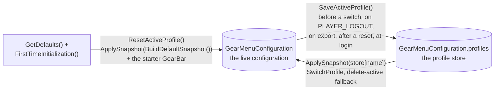
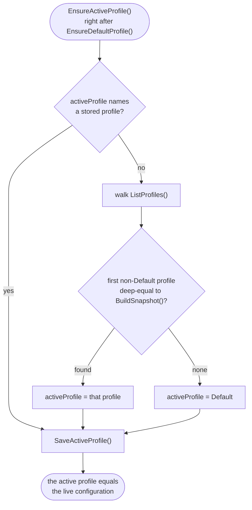

# Development

#### Invtypes

A list of invtypes that are relevant to the addon

INVTYPE_HEAD
INVTYPE_NECK
INVTYPE_SHOULDER
INVTYPE_CHEST
INVTYPE_ROBE
INVTYPE_WAIST
INVTYPE_LEGS
INVTYPE_FEET
INVTYPE_WRIST
INVTYPE_HAND
INVTYPE_FINGER
INVTYPE_TRINKET
INVTYPE_CLOAK
INVTYPE_WEAPON
INVTYPE_SHIELD
INVTYPE_2HWEAPON
INVTYPE_WEAPONMAINHAND
INVTYPE_WEAPONOFFHAND
INVTYPE_HOLDABLE
INVTYPE_RANGED
INVTYPE_THROWN
INVTYPE_RANGEDRIGHT
INVTYPE_RELIC
INVTYPE_AMMO


#### SlotTypes

A list of slotTypes that are relevant to the addon

* INVSLOT_HEAD
* INVSLOT_NECK
* INVSLOT_SHOULDER
* INVSLOT_CHEST
* INVSLOT_WAIST
* INVSLOT_LEGS
* INVSLOT_FEET
* INVSLOT_WRIST
* INVSLOT_HAND
* INVSLOT_FINGER1
* INVSLOT_FINGER2
* INVSLOT_TRINKET1
* INVSLOT_TRINKET2
* INVSLOT_BACK
* INVSLOT_MAINHAND
* INVSLOT_OFFHAND
* INVSLOT_RANGED
* INVSLOT_AMMO

## Development Tools

### Docker Compose Services

The project includes Docker Compose services for development and validation tasks. Each service is containerized and requires no local setup beyond Docker.

**Available Services:**

```bash
# Code Quality
docker compose run --rm luacheck                    # Run lua linting
docker compose run --rm luacheck-report             # Generate lua lint report

# Tests
docker compose run --rm busted                      # Run busted unit tests
docker compose run --rm busted-report               # Generate busted test report
```

**Output Files:**
Services with "-report" suffix generate output files in the `./target/` directory:
- `./target/luacheck-junit.xml` - Luacheck results in JUnit format
- `./target/busted-junit.xml` - Busted test results in JUnit format

### In-game showcases

The development `.toc` loads the `dev/` modules, which register sub-commands on `/rggm`
that never show up in `/rggm help`:

- `/rggm showcase` toggles a window that renders every state of a slot - item, empty slot,
  hover, pushed, cooldown, bound key, queued item, right-click flash, Quick Keybind Mode and
  an old item icon - at 24, 40 and 64 px, each next to a real Blizzard action button in the
  same state, plus a bar of four at the action bar pitch (`dev/SlotShowcase.lua`)
- `/rggm showcase trinkets` feeds the real TrinketMenu (and the ChangeMenu of a trinket
  slot) a fixed list of Classic trinkets, some on cooldown, until it is toggled off;
  `/rggm showcase changemenu` feeds that list to the ChangeMenu of every GearSlot instead
  (`dev/TrinketShowcase.lua`)
- `/rggm shot ...` drives the media capture, see the wow-media-capture skill
  (`dev/Capture.lua`)

### Running Luacheck

The project uses [Luacheck](https://github.com/lunarmodules/luacheck), a static analyzer and linter for Lua, to ensure code quality and catch common issues.

**To run Luacheck:**

```bash
docker compose run --rm luacheck
```

This will:
- Mount the project directory as read-only
- Run Luacheck on all Lua files
- Output any warnings or errors found

**To generate a report:**
```bash
docker compose run --rm luacheck-report
```

This generates a JUnit XML report in `./target/luacheck-junit.xml`.

**Configuration:**
- `.luacheckrc` - Contains Luacheck configuration, including:
  - Global variables specific to WoW addons
  - Lua 5.1 standard for compatibility
  - Excluded directories (e.g., `target/`)

### Running Tests

The project uses [busted](https://lunarmodules.github.io/busted/) for headless unit tests. Specs
live under `test/headless/spec/`; a busted helper at `test/headless/Bootstrap.lua` sets up the addon
globals and loads the pure modules so they can be tested without the WoW client running. The
`test/headless/` subfolder keeps these headless specs separate from the manual in-game test cases
under `test/manual/`. The release test procedure - automated gates, the in-game test matrix and
the manual test case catalog - is documented in [test/TESTING.md](test/TESTING.md).

**To run the test suite:**

```bash
docker compose run --rm busted
```

This will:
- Mount the project directory as read-only
- Run busted against the `test/headless/spec/` directory (configured via `.busted`)
- Report the number of successes / failures / errors

**To generate a report:**
```bash
docker compose run --rm busted-report
```

This generates a JUnit XML report in `./target/busted-junit.xml`.

**Configuration:**
- `.busted` - busted run configuration (spec root, the bootstrap helper, the `Spec.lua` pattern)
- `test/headless/Bootstrap.lua` - test globals and pure-module bootstrap
- `test/headless/WowStubs.lua` - opt-in registry of WoW-global stubs

**Modules deliberately without a spec:**
- `gui/AboutContent.lua` - builds a logo and four fixed font strings; no branches or state to pin
- `gui/QuickChangeMenu.lua` - deferred while QuickChange is disabled
  (`RGGM_CONSTANTS.QUICK_CHANGE_ENABLED`) (`code/QuickChange.lua` itself is covered by `QuickChangeSpec`)

### Testing and Code Quality

Before committing changes:

1. Run Luacheck to ensure code quality: `docker compose run --rm luacheck`
2. Run the unit tests: `docker compose run --rm busted`
3. Test the addon in-game with `/reload` to ensure functionality works correctly
4. Verify the addon loads without errors

## Build and Release

### Switching between Environments

Switching between development and release can be achieved with maven.

```
mvn generate-resources -D generate.sources.overwrite=true -P development
```

This generates and overwrites `code/Environment.lua` and `GearMenu.toc`. You need to specifically specify that you want to overwrite the files to prevent data loss. It is also possible to omit the profile because development is the default profile that will be used.

Switching to release can be done as such:

```
mvn generate-resources -D generate.sources.overwrite=true -P release
```

In this case it is mandatory to add the release profile.

**Note:** Switching environments has the effect of changing certain files to match an expected value depending on the environment. To be more specific, this means that, for example, test and debug files are not included when switching to release. It also means that variables such as loglevel change to match the environment.

To avoid changing those files all the time the repository should always stay in the development environment. Do not commit `GearMenu.toc` and `code/Environment.lua` in their release state. Changes to those files should always be done inside `build-resources` and their respective template files marked with `.tpl`.

### Packaging the Addon

To package the addon use the `package` phase.

```
mvn package -D generate.sources.overwrite=true -P development
```

This generates an addon package for development. For generating a release package the release profile can be used.

```
mvn package -D generate.sources.overwrite=true -P release
```

The release package takes `code/Environment.lua` from the working tree, so the overwrite flag is required. It also leaves `GearMenu.toc` and `code/Environment.lua` in their release state. Switch back to development right after packaging so they are not committed by accident:

```
mvn generate-resources -D generate.sources.overwrite=true -P development
```

**Note:** This packaging and switching resources can also be done one after another.

**Note:** The packaging is not fit to be used for CurseForge because CurseForge expects a specific packaging

```
# switch environment to release
mvn generate-resources -D generate.sources.overwrite=true -P release
# package release
mvn package -P release
# switch environment back to development
mvn generate-resources -D generate.sources.overwrite=true -P development
```

### Deploy GitHub Release

Before creating a new release update `addon.tag.version` in `pom.xml`. Afterwards to create a new release and deploy to GitHub the `deploy-github` profile has to be used.

```
# switch environment to release
mvn generate-resources -D generate.sources.overwrite=true -P release
# deploy release
mvn package -P deploy-github -D github.auth-token=[token]
# switch environment back to development
mvn generate-resources -D generate.sources.overwrite=true -P development
```

**Note:** This is only intended for manual deployment to GitHub. With GitHub actions the token is supplied as a secret to the build process

### Deploy CurseForge Release

**Note:** It's best to create the release for GitHub first and only afterwards the CurseForge release. That way the tag was already created.

```
# switch environment to release
mvn generate-resources -D generate.sources.overwrite=true -P release
# deploy release
mvn package -P deploy-curseforge -D curseforge.auth-token=[token]
# switch environment back to development
mvn generate-resources -D generate.sources.overwrite=true -P development
```

**Note:** This is only intended for manual deployment to CurseForge. With GitHub actions the token is supplied as a secret to the build process

### GitHub Action Profiles

This project has GitHub action profiles for different DevOps-related work such as linting and deployments to different providers. See `.github` folder for details.

## Profiles

The configuration profiles (`code/Profile.lua`, `rggm.profile`; the page is
`gui/ProfileMenu.lua`) are the family feature every sibling addon carries, cloned from
the Quartermaster reference implementation (family spec CMI-0006) - keep the shape below
when touching it, so a reader can move between the repos.

**Two data homes.** The live configuration is `GearMenuConfiguration`: what every
setter writes and every reader reads. The profile store is
`GearMenuConfiguration.profiles = { [name] = snapshot }`, one stored copy per profile. A
profile captures the `PROFILE_FIELD_SPEC` fields - the general options, the item quality
filter, `gearBars` (every bar with its slots, sizes, orientation, lock state, key-binding
labels and position), `quickChangeRules`, `frames`, the TrinketMenu settings and the
base-item fallback. Bookkeeping stays out of
it: `addonVersion`, `firstTimeInitializationDone`, the store itself and `activeProfile`,
the name of the profile the live configuration belongs to. `activeProfile` is written
only by `EnsureActiveProfile`, `SwitchProfile`, `CreateProfile`, `DeleteProfile` and
`RenameProfile`, and it is deliberately absent from `CONFIGURATION_DEFAULTS` - a
backfilled `"Default"` would make the adoption below dead code.

**The mirror rule.** Edits always belong to the active profile, but nothing hooks the
setters. `SaveActiveProfile()` copies the live configuration into `store[activeProfile]`
at five moments: before a switch, on `PLAYER_LOGOUT` (a gated bus registration in
`Core`; the event fires on logout, `/reload` and disconnect before the SavedVariables are
written, and not on a crash), on export, after a reset, and at the end of
`EnsureActiveProfile()` at every login - the self-heal for a logout the mirror missed.
Between those moments the live SavedVariable is the truth. A nil or dangling active
name is repaired to Default before the mirror lands.

**Adoption at login.** `Core.Initialize` runs `EnsureDefaultProfile()`, which seeds
Default only when the store has none, and then `EnsureActiveProfile()`: a store that
names a stored profile keeps it; the first login after the upgrade from the snapshot
model (no `activeProfile` yet) or a name whose profile went activates the first
non-Default profile whose stored copy deep-equals the live configuration
(`Common.DeepEquals` - the player applied it and changed nothing since), else Default.
Either way the login ends with the active profile equal to the live configuration.

**Default and Reset to defaults.** Default is the editable home profile every character
starts on: never deleted, renamed, imported over or created over
(`profile_error_default_cannot_be_overwritten` reads "reserved name"), otherwise a
profile like any other. The factory settings are not a profile any more -
`ResetActiveProfile()` applies `BuildDefaultSnapshot()` (`GetDefaults()`, the userOwned
collections empty) to the live configuration, runs
`Configuration.FirstTimeInitialization()` so the starter "Default GearBar" (trinket 1 /
trinket 2 / head) comes back like on a fresh install, and mirrors the result into the
active profile.

**Switch, delete, export.** `SwitchProfile(name)` mirrors, applies `store[name]` and
makes it active. `DeleteProfile(name)` of the active profile applies Default and
returns a second value `fellBack`, with no mirror before or after (it would resurrect
the deleted profile). Every page path that applies a snapshot - Load, Reset to
defaults, deleting the active profile - is refused in combat and wrapped in the
key-binding dance: `keyBind.ClearGearBarKeyBindings()` before (clears the keys of every
GearMenu proxy action, so the outgoing profile's keys do not linger on slots the incoming
one leaves unbound), `keyBind.ApplyGearBarKeyBindings()` after (binds the `keyBinding`
mirror of every slot to its proxy action - the profile carries the keys, not WoW's
binding set), then `ReloadUI()` so every GearBar, the ChangeMenu and the TrinketMenu
rebuild from the applied state (the post-reload logout mirror re-writes the
`SetupConfiguration`-normalised copy - harmless). The reload is not needed for the
bindings themselves any more - the proxy names are static. Export mirrors first and then exports
the stored copy of the selected row, so the active row exports the live settings; an
import is stored inactive. Accepted quirk: a stored profile from an older schema lacks
the newer fields, `ApplySnapshot` keeps the live value for those and the first mirror
persists it.

**Adding a field to a profile.** One entry in `CONFIGURATION_DEFAULTS` in
`code/Configuration.lua` (the backfill covers existing characters) and one line in
`PROFILE_FIELD_SPEC` in `code/Profile.lua` with its Lua type (import validates it).
Never `activeProfile`.

**Page to module.** Every confirm answers Yes / No, every name prompt Accept / Cancel;
the click guards print the refusal a greyed button already shows. "Key-binding dance"
means `ClearGearBarKeyBindings` before the module call and `ApplyGearBarKeyBindings`
after it, right before the `ReloadUI()`.

| Button / popup | Module call | Greyed while | Reloads |
|---|---|---|---|
| Create new Profile (`RGGM_PROFILE_CREATE`, name prompt) | `CreateProfile(name)` - mirror, copy, activate | never | no |
| Load (`RGGM_PROFILE_LOAD`) | `SwitchProfile(name)`, key-binding dance around it | nothing selected, the active row | yes |
| Rename (`RGGM_PROFILE_RENAME`, name prompt) | `RenameProfile(old, new)` - the active name follows | nothing selected, Default | no |
| Delete (`RGGM_PROFILE_DELETE`, `RGGM_PROFILE_DELETE_ACTIVE` on the active row) | `DeleteProfile(name)` -> `deleted, fellBack`, key-binding dance on the active row | nothing selected, Default | only when `fellBack` |
| Reset to defaults (`RGGM_PROFILE_RESET`) | `ResetActiveProfile()`, key-binding dance around it | never | yes |
| Export | `SaveActiveProfile()`, then `ExportString(GetProfile(name), name)` | nothing selected | no |
| Import (`RGGM_PROFILE_IMPORT`, name prompt prefilled from the string) | `ImportString(text)`, then `SaveProfile(name, payload)` - stored inactive | never | no |
| Key-binding dance (every reload above) | `keyBind.ClearGearBarKeyBindings()` before, `keyBind.ApplyGearBarKeyBindings()` after | in combat | precedes `ReloadUI()` |

**Profile data flow**



**Adoption at login**



## Key Bindings

GearMenu binds keys through the game's own keybinding system; it has no key capture of its
own. Three modules share the work:

- **`gui/KeyBindProxy.lua`** creates one hidden `SecureActionButtonTemplate` button per
  possible GearSlot at initialization - `MAX_GEAR_BARS x MAX_GEAR_BAR_SLOTS`, named
  `GM_KeyBindBar<bindIndex>Slot<position>` - and keeps each one's macro pointed at the
  `/use <slotId>` of the slot configured at that `(bindIndex, position)` (`Update()`, called
  by `GearBarManager` after every bar / slot change). The real GearSlot frames carry a random
  bar id in their name and are never binding targets. Every gearBar holds a persisted
  `bindIndex` (1..`MAX_GEAR_BARS`, lowest free one on creation, backfilled by
  `EnsureBindIndices` in `SetupConfiguration`) so deleting another bar does not shift its keys.
- **`Bindings.xml`** (repo root, auto-loaded by the client, not in the TOC, included by both
  assembly descriptors) declares the 200 `CLICK GM_KeyBindBar<b>Slot<p>:LeftButton` actions
  under `BINDING_HEADER_GEARMENU` with a `PREFACE_GEARMENU_BAR<b>` text row per bar. The
  names come from `keybind_category` / `keybind_bar_preface` / `keybind_slot_name` in the
  localization and are set as globals by `KeyBindProxy` at file load. Positional names on
  purpose - the list is only rebuilt on `ADDON_LOADED` / reload.
- **`gui/KeyBind.lua`** reads and writes bindings against those actions with WoW's binding
  set as the single source of truth: the label on a slot and in the configuration row is
  `GetBindingKey(proxyAction)`, refreshed on `UPDATE_BINDINGS` (gated) and once at
  initialization; `slot.keyBinding` is only a mirror kept as the profile export payload.
  GearMenu writes bindings in three cases - the row's `Unbind` button, the key shift after a
  slot removal (`OnGearSlotRemoved`, keys follow the slots that move up) and the profile dance
  (`ClearGearBarKeyBindings` / `ApplyGearBarKeyBindings`) - and every write goes through
  `WhenOutOfCombat`: refused by the client during combat lockdown, so it is queued and run on
  `PLAYER_REGEN_ENABLED` (`FlushPending`, dispatched from `Core`), with one chat notice.

**Quick Keybind Mode.** GearSlots inherit `QuickKeybindButtonTemplate` (listed before
`SecureActionButtonTemplate` so the secure `OnClick` wins) and carry
`commandName = proxyAction`; `GearBar` forwards `OnEnter` / `OnLeave` to the
`QuickKeybindButtonTemplateMixin` and hooks `QuickKeybindFrame` `OnShow` / `OnHide` to toggle
the highlight (`DoModeChange`) on every slot. The configuration's `Key Bindings` button opens
Settings > Keybindings at the GearMenu section (`Settings.OpenToCategory` with the section
expanded, the way Blizzard's ping settings do), `Quick Keybind Mode` closes the settings and
shows `QuickKeybindFrame` (refused in combat).

Headless coverage: `KeyBindProxySpec` (creation, mapping, deferral), `KeyBindReconcileSpec`
(reads, writes, shift, profile pair, deferral queue) against the in-memory `BindingSet` and
`FrameRegistry` stubs in `test/headless/WowStubs.lua`.

## Local Functions

A file-private helper is a plain `local function Name()` defined above its first caller, so a
module reads bottom-up: helpers first, then the public `me.X` functions that use them. Self-recursion
needs nothing extra - the name is in scope inside its own body. Forward-declare a local
(`local Name` and later `Name = function()`) only for mutual recursion; group those declarations in
one commented block at the top of the file. A local function referenced before its definition
reads an undefined global, which `luacheck` reports.

## Localization

`localization/enUS.lua` is the source of truth: it defines every key, and the other locales
(`deDE`, `ruRU`, `zhCN`) translate that same key set inside their `GetLocale()` guard. Add or remove a
key in all four files together. `LocalizationParitySpec` enforces this headlessly - every locale
must carry exactly the enUS keys and the same `string.format` placeholders, and every enUS key must
be used somewhere in `code/` or `gui/`. Remove a key together with the last UI that uses it.

## Dependency Management

This repository uses [Renovate](https://renovatebot.com/) for automated dependency updates. Renovate monitors and updates:

- Maven dependencies (plugins and libraries)
- GitHub Actions versions
- Docker image tags in `docker-compose.yml`

The World of Warcraft: Forever values in `pom.xml` (`addon.interface.forever`,
`addon.supported.patch.forever`, `addon.curseforge.gameVersionForever`) are not Renovate-managed:
wow-renovate-data has no Forever variant (the CurseForge game version 17053 is still tagged
`unknown` there). Bump them by hand when the beta reports a new interface version, then regenerate
the sources. There is no Wago release for this line as long as Wago has no Forever game field.

The configuration can be found in `renovate.json`. Renovate runs on a weekly schedule and creates pull requests for available updates.
